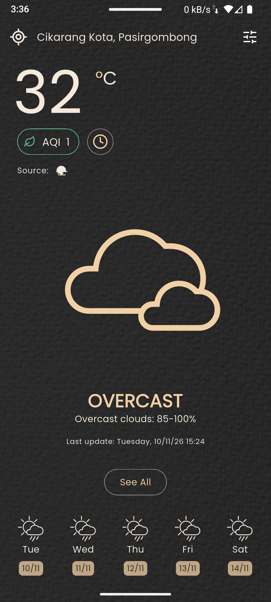
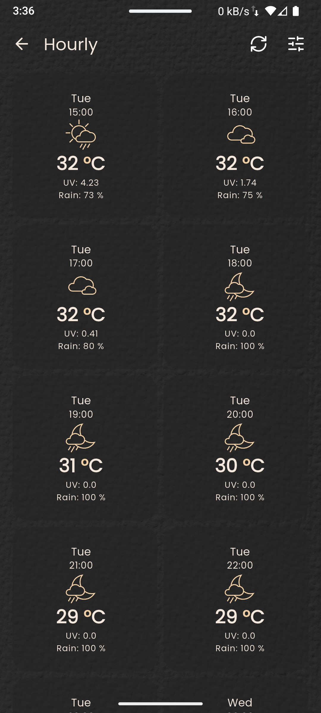
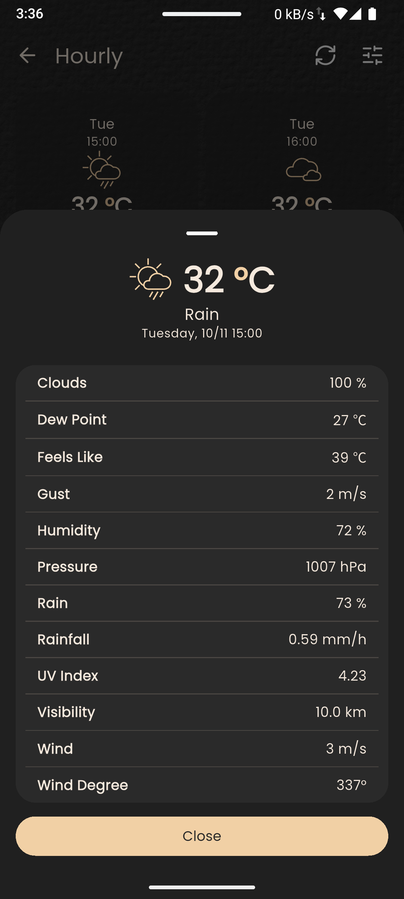
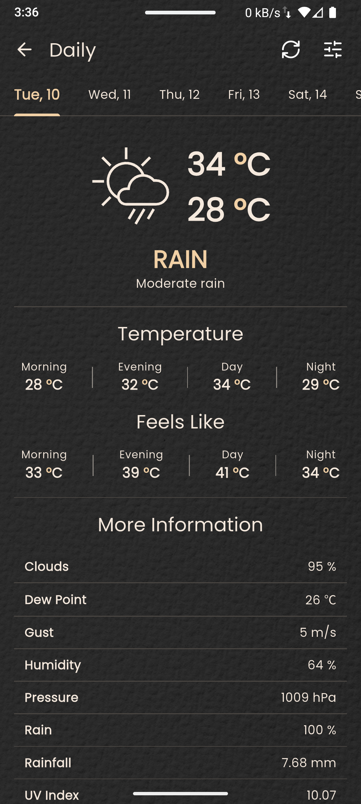
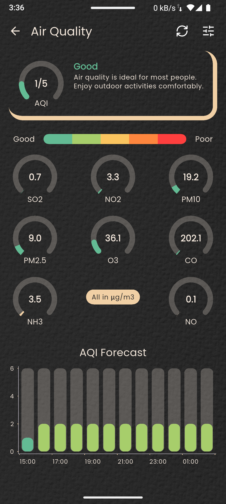
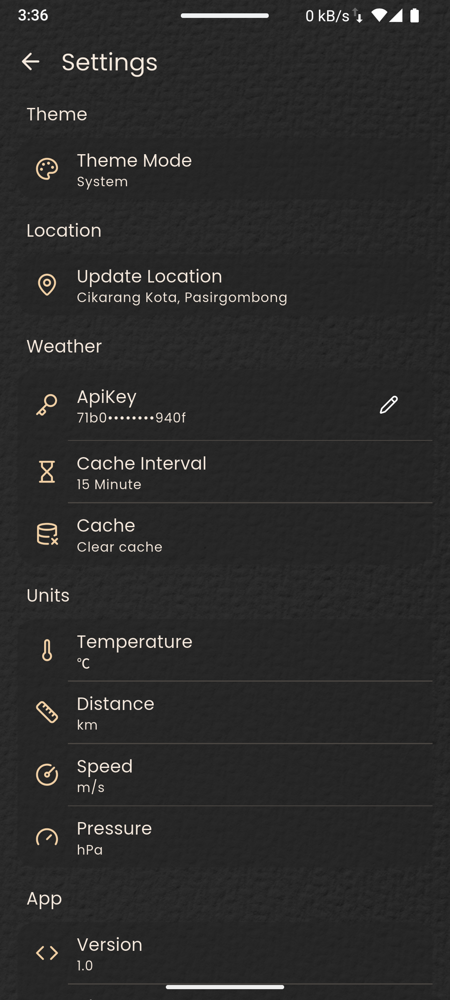

# 🌤️ Weather App Flutter

A modern, full-featured weather forecast and Air Quality Index (AQI) monitoring application built with Flutter, powered by the OpenWeatherMap API, Riverpod state management, and Syncfusion interactive data visualizations.

---

## 📱 Screenshots

|                                    Home                                    |                                 Hourly Forecast                                  |                                     Hourly Detail                                     |
| :------------------------------------------------------------------------: | :------------------------------------------------------------------------------: | :-----------------------------------------------------------------------------------: |
|  |  |  |

|                                 Daily Forecast                                 |                             Air Quality Index (AQI)                             |                                      Settings                                      |
| :----------------------------------------------------------------------------: | :-----------------------------------------------------------------------------: | :--------------------------------------------------------------------------------: |
|  |  |  |

---

## ✨ Features

- **🌡️ Real-Time Current Weather**: View current temperature, "feels like" temperature, weather condition descriptions, humidity, wind speed, atmospheric pressure, UV index, and dew point.
- **⏱️ Hourly Forecast & Charts**: Detailed hour-by-hour forecast accompanied by interactive temperature trend charts powered by Syncfusion Flutter Charts.
- **📅 Daily Forecast**: Multi-day weather predictions with high/low temperatures, sunrise/sunset times, and precipitation chances.
- **🍃 Air Quality Index (AQI)**:
    - Real-time air quality measurements displayed with animated radial gauges.
    - Granular pollutant tracking for $\text{SO}_2$, $\text{NO}_2$, $\text{PM}_{10}$, $\text{PM}_{2.5}$, $\text{O}_3$, and $\text{CO}$.
    - Color-coded safety categories (_Good_, _Fair_, _Moderate_, _Poor_, _Very Poor_).
    - AQI forecast overview.
- **📍 Location Services**: Automatic current location detection via GPS (`geolocator` and `geocoding`) along with support for manual coordinate configuration.
- **⚙️ Customization & Settings**:
    - **Temperature Units**: Celsius (°C), Fahrenheit (°F), Kelvin (K).
    - **Wind Speed Units**: m/s, km/h, mph.
    - **Pressure Units**: hPa, inHg, mmHg.
    - **Distance Units**: Kilometers (km), Miles (mi).
    - **Theme Modes**: System, Light, and Dark themes with custom background graphics.
    - **Configurable Cache Interval**: Reduce API calls with local cache durations (5, 15, 30, or 60 minutes).
- **🔄 Smooth UX**: Pull-to-refresh (`easy_refresh`), shimmer loading placeholders, and smooth custom page transitions.

---

## 🏗️ Architecture & Project Structure

The project follows a clean, feature-driven structure with repository patterns and Riverpod code-generation:

```text
lib/
├── data/
│   ├── api/             # OpenWeatherMap API client
│   ├── cache/           # Local caching with SharedPreferences
│   ├── controllers/     # Riverpod controllers (Weather & AQI)
│   ├── models/          # Data models (OneCall & AQI responses)
│   └── repositories/    # Repository layer handling API & cache orchestration
├── features/
│   ├── aqi/             # AQI screens and gauges
│   ├── daily/           # Daily forecast views
│   ├── home/            # Main dashboard and weather summary
│   ├── hourly/          # Hourly charts and timeline
│   ├── settings/        # Settings screen, preferences, and API key management
│   └── widgets/         # Shared feature widgets (shimmers, detail items)
├── providers/           # Global providers (Dio, SharedPreferences, SnackBar)
├── routes/              # GoRouter configuration & page transitions
├── theme/               # Light & dark theme data
└── utils/               # Constants, unit conversion helpers, and extensions
```

---

## 🛠️ Tech Stack & Dependencies

| Category             | Technology / Package                                                                                                                                                                                                                                                         |
| -------------------- | ---------------------------------------------------------------------------------------------------------------------------------------------------------------------------------------------------------------------------------------------------------------------------- |
| **Framework**        | [Flutter](https://flutter.dev) (SDK `^3.13.7`)                                                                                                                                                                                                                               |
| **State Management** | [Riverpod 3](https://riverpod.dev/) (`hooks_riverpod`, `riverpod_annotation`, `riverpod_generator`)                                                                                                                                                                          |
| **Routing**          | [GoRouter](https://pub.dev/packages/go_router)                                                                                                                                                                                                                               |
| **Networking**       | [Dio](https://pub.dev/packages/dio)                                                                                                                                                                                                                                          |
| **Local Storage**    | [SharedPreferences](https://pub.dev/packages/shared_preferences)                                                                                                                                                                                                             |
| **Charts & Gauges**  | [Syncfusion Flutter Charts](https://pub.dev/packages/syncfusion_flutter_charts), [Syncfusion Flutter Gauges](https://pub.dev/packages/syncfusion_flutter_gauges)                                                                                                             |
| **Location**         | [Geolocator](https://pub.dev/packages/geolocator), [Geocoding](https://pub.dev/packages/geocoding)                                                                                                                                                                           |
| **UI & Styling**     | [Lucide Icons](https://pub.dev/packages/lucide_icons_flutter), [Google Fonts](https://pub.dev/packages/google_fonts), [Shimmer](https://pub.dev/packages/shimmer), [EasyRefresh](https://pub.dev/packages/easy_refresh), [Material UI](https://pub.dev/packages/material_ui) |

---

## 🚀 Getting Started

### Prerequisites

- [Flutter SDK](https://docs.flutter.dev/get-started/install) installed (SDK `^3.13.7`).
- An API key from [OpenWeatherMap](https://openweathermap.org/api) (One Call API & Air Pollution API).

### Installation

1. **Clone the repository**:

    ```bash
    git clone https://github.com/<your-username>/weather_app_flutter.git
    cd weather_app_flutter
    ```

2. **Install dependencies**:

    ```bash
    flutter pub get
    ```

3. **Generate code (Riverpod & Routes)**:

    ```bash
    dart run build_runner build --delete-conflicting-outputs
    ```

4. **Run the application**:

    ```bash
    flutter run
    ```

---

## 🔑 Configuration & Setup

Once the app is running:

1. Navigate to the **Settings** screen (settings gear icon in the app).
2. Enter your **OpenWeatherMap API Key**.
3. Allow location permissions when prompted to automatically load local weather, or specify manual coordinates.

---

## 📱 Permissions

Make sure the required platform permissions are properly configured:

- **Android** (`android/app/src/main/AndroidManifest.xml`):
    - `android.permission.INTERNET`
    - `android.permission.ACCESS_FINE_LOCATION`
    - `android.permission.ACCESS_COARSE_LOCATION`
- **iOS** (`ios/Runner/Info.plist`):
    - `NSLocationWhenInUseUsageDescription`

---

## 📄 License

This project is open-source and available under standard open licensing terms.
